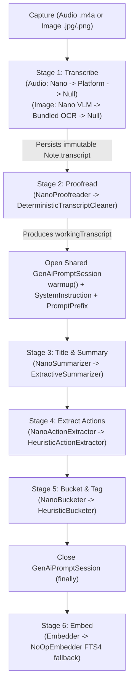

<!-- SPDX-License-Identifier: Apache-2.0 -->

# On-Device AI on Modern Android: A Reference Guide

**Voice Note Sorter** is a production-structured reference app for building **100% local, zero-server Android AI** with **ML Kit GenAI (Gemini Nano via AICore)**, **ML Kit Bundled Text Recognition**, **on-device SpeechRecognizer**, **Jetpack Compose + Navigation 3**, **Room FTS4 + vector storage**, and **WorkManager**.

The core architectural thesis: **treat every on-device AI capability as a runtime-probed ladder, never a static feature flag.** Flagship models are quota-limited, occasionally busy, sometimes not yet downloaded, and blocked in the background (`ErrorCode 30`)—so the pipeline must degrade gracefully per stage without ever losing a user's note.

---

## 1. The Capability Ladder Pattern

Instead of checking `Build.MODEL` or gating features behind booleans, every AI capability sits behind a pure Kotlin contract in [`extension-api`](../extension-api/src/main/java/com/icanbenchurcat/voicenotes/ai/Capabilities.kt):

| Rung | `Tier` | Transcription (Audio) | Image / Handwriting | Proofread | Title & Summary | Action Extraction | Bucketing | Search |
| :--- | :--- | :--- | :--- | :--- | :--- | :--- | :--- | :--- |
| **Tier 3 — Full** | `Tier.FULL` | `NanoTranscriber` (`MODE_ADVANCED`) | `NanoImageTranscriber` (`ImagePart(Bitmap)`) | `NanoProofreader` (`GenAiPromptClient`) | `NanoSummarizer` (`@Generable` JSON) | `NanoActionExtractor` (`@Generable` JSON) | `NanoBucketer` (`@Generable` JSON) | `Embedder` (`AVAILABLE`) + FTS4 |
| **Tier 2 — Core** | `Tier.CORE` | `NanoTranscriber` (`MODE_BASIC`) / `PlatformTranscriber` (API 33+) | `MlKitOcrImageTranscriber` (bundled ML Kit OCR) | `DeterministicTranscriptCleaner` | `ExtractiveSummarizer` | `HeuristicActionExtractor` + `PlatformDateParser` | `HeuristicBucketer` | FTS4 (`notes_fts`) |
| **Tier 1 — Minimal** | `Tier.MINIMAL` | `NullTranscriber` (audio preserved for playback) | `NullImageTranscriber` (image preserved for manual entry) | `DeterministicTranscriptCleaner` | Timestamp title | Empty list | `INBOX` + `NEEDS_REVIEW` | FTS4 on manual titles |

### Probing Honestly (`CapabilityProbe`)
[`CapabilityProbe`](../app/src/main/java/com/icanbenchurcat/voicenotes/ai/CapabilityProbe.kt) checks each capability independently (`AVAILABLE`, `DOWNLOADABLE`, `UNAVAILABLE`, `BUSY`), caches results in `DataStore`, and invalidates automatically when either the app `versionCode` or `com.google.android.aicore` `longVersionCode` changes.

Two field lessons from real hardware and emulators:
1. **`SpeechRecognizer.checkStatus()` can throw instead of returning `UNAVAILABLE`.** On emulators or non-whitelisted devices, the gRPC binder call throws `zzaxh: PERMISSION_DENIED: Api access revoked.` Wrap every `checkStatus()` call in `try/catch` and map exceptions to `CapabilityStatus.UNAVAILABLE`.
2. **Android 11+ `<queries>` visibility.** Without `<queries><package android:name="com.google.android.aicore" /></queries>` in `AndroidManifest.xml`, `getPackageInfo("com.google.android.aicore", 0)` throws `NameNotFoundException`. `DeviceCapabilityChecker` catches this defensively and falls back cleanly.

---

## 2. The 6-Stage Fault-Tolerant Pipeline (`SortingWorker`)

[`SortingWorker`](../app/src/main/java/com/icanbenchurcat/voicenotes/service/SortingWorker.kt) executes six independently failable stages. Every stage persists its own result and appends its outcome (`OK`, `BUSY`, `SKIPPED`, `FAILED`) to `Note.stageStatus`.



Key design invariants:
- **Immutable raw transcript (`ADR 0006`):** Stage 1 persists `Note.transcript` immediately and never overwrites it. Stage 2 (`Proofreader`) outputs a separate `workingTranscript` consumed only by Stages 3–6.
- **Idempotency:** Re-running `SortingWorker` on the same `noteId` replaces extracted actions/tags cleanly and skips Stage 6 if `note_embeddings.modelId == embedder.modelId`.
- **Demotion is not an error:** When a stage throws `CapabilityBusyException`, `SortingWorker` falls back to Tier 2 for that stage, records `:BUSY`, and marks `NoteStatus.NEEDS_REVIEW` so the note is never lost.

---

## 3. ML Kit GenAI Prompt API in Practice (`GenerativeAi.kt`)

All Gemini Nano Prompt API logic is isolated behind [`GenAiPromptClient`](../app/src/main/java/com/icanbenchurcat/voicenotes/ai/GenerativeAi.kt) and [`GenAiPromptSession`](../app/src/main/java/com/icanbenchurcat/voicenotes/ai/GenerativeAi.kt).

### 3.1 Type-Safe Structured Output (`@Generable`)
Instead of fragile prompt-and-pray parsing alone, Stages 3–5 define `@Generable` schema classes processed at compile time by `com.google.mlkit:genai-schema-compiler` (KSP):
- `StructuredTitleSummary` (`title`, `summary`)
- `StructuredActionExtraction` (`actions: List<StructuredActionItem>`)
- `StructuredBucketAssignment` (`bucketKind`, `tags`, `confidence`)

At runtime, [`MlKitGenAiPromptClient`](../app/src/main/java/com/icanbenchurcat/voicenotes/ai/GenerativeAi.kt) checks whether the active model supports `STRUCTURED_OUTPUT` (`GenerateTypedContentRequest` + `outputClass`) and automatically falls back to plain-text generation + strict regex/JSON parsing if structured output is unavailable on a given model version (`ADR 0005`).

### 3.2 Shared Session, Warmup, and KV Prefix Caching
Opening a fresh model session for each stage wastes latency and re-evaluates the transcript three times. Instead, `SortingWorker` opens **one** `GenAiPromptSession` across Stages 3–5:
1. Calls `session.warmup()` (~`75 ms` measured on Pixel 10 Pro XL) before Stage 3.
2. Attaches a shared `SystemInstruction` (role framing) and transcript `PromptPrefix` when `PREFIX_CACHING` is supported.
3. Reuses the cached KV prefix across `NanoSummarizer`, `NanoActionExtractor`, and `NanoBucketer`, then clears implicit caches and closes the session in `finally`.

### 3.3 Critical Physical-Device Lesson: Background Usage Blocked (`ErrorCode 30`)
On physical Android 17 / AICore hardware (`Pixel 10 Pro XL`, `com.google.android.aicore` `545573`), calling `genai-prompt` when no `Activity` is in the foreground throws:

```text
com.google.mlkit.genai.common.GenAiException: [ErrorCode 30] Background usage is blocked.
Please use the API when your app is in the foreground instead.
```

Because Quick Settings tile launches, Glance widget taps, or screen-off recording stops can trigger `SortingWorker` while the app is backgrounded, `MlKitGenAiPromptClient.isBusyOrQuotaError()` treats `GenAiException.ErrorCode.BACKGROUND_USE_BLOCKED` (`30`) identically to `BUSY` and `PER_APP_BATTERY_USE_QUOTA_EXCEEDED`: it throws `CapabilityBusyException`, causing the pipeline to demote to Tier 2 heuristics and mark `NEEDS_REVIEW` rather than failing.

---

## 4. Saved-File Audio Transcription (`Transcribers.kt`)

Deferred background workers cannot open a live microphone. [`Transcribers.kt`](../app/src/main/java/com/icanbenchurcat/voicenotes/ai/Transcribers.kt) handles saved `.m4a` files across API 31–37:

1. **Tier 3 / Tier 2 (`NanoTranscriber`):** Uses `AudioSource.fromFile(File(audioPath))` (`AudioSource.Mode.ONE_SHOT`) with `MODE_ADVANCED` first, falling back to `MODE_BASIC`.
   - **Gotcha:** Passing `recognitionOptions.enableWordTiming = true` with `AudioSource.fromFile(...)` immediately throws `IllegalArgumentException("Word timing is not supported with AudioSource.Mode.ONE_SHOT.")`. Leave `enableWordTiming = false`.
2. **Tier 2 Platform (`PlatformTranscriber`):**
   - **API 33+:** Decodes compressed `.m4a` audio via `MediaExtractor` + `MediaCodec` to 16 kHz 16-bit mono PCM and streams it into `RecognizerIntent.EXTRA_AUDIO_SOURCE` over `ParcelFileDescriptor.createPipe()` on `Dispatchers.Main` using `SpeechRecognizer.createOnDeviceSpeechRecognizer(context)`.
   - **API 31–32:** `EXTRA_AUDIO_SOURCE` does not exist in `android-31`. `PlatformTranscriber.status()` honestly reports `UNAVAILABLE` for saved files and falls through to `NullTranscriber` (`Tier.MINIMAL`).

---

## 5. Zero-Permission Image & Handwriting Notes (`ImageTranscribers.kt`)

[`ImageTranscribers.kt`](../app/src/main/java/com/icanbenchurcat/voicenotes/ai/ImageTranscribers.kt) (`ADR 0008`) extracts text from photos of whiteboards or handwritten notes **without adding `CAMERA` or `READ_MEDIA_IMAGES` permissions**:
- **Capture:** Uses Android's system Photo Picker (`PickVisualMedia`) and system camera delegation (`TakePicture`) into an app-private `FileProvider` URI (`filesDir/images/`).
- **Tier 3 (`NanoImageTranscriber`):** Sends a safely downscaled `Bitmap` via `ImagePart(bitmap)` to `genai-prompt` (`nano-v4-full`).
- **Tier 2 (`MlKitOcrImageTranscriber`):** Uses the **bundled** `com.google.mlkit:text-recognition:16.0.1` artifact (offline Latin model inside the APK). The Play Services unbundled variant is explicitly prohibited in Open Core because it downloads models over the network.
- **Tier 1 (`NullImageTranscriber`):** Keeps the image attached on `NoteDetailScreen` and flags `NEEDS_REVIEW` for manual annotation.

---

## 6. Hybrid Search & Structural Open-Core Boundary

- **Hybrid Search (`ADR 0007`):** [`DefaultSearchRepository`](../app/src/main/java/com/icanbenchurcat/voicenotes/data/SearchRepository.kt) combines Room FTS4 lexical scores (`0.5f`) with cosine similarity (`0.5f`, threshold `0.25f`) over `note_embeddings` rows whose `modelId` matches `Embedder.modelId`. Open Core ships `NoOpEmbedder` (`modelId = "noop"`), so search runs pure FTS4 while the schema, Stage 6 backfill hook, and `NoteDeletionCoordinator` atomic cascade delete are already in place for downstream neural embedders.
- **One-Way Extension Seam (`ADR 0002`, `ADR 0011`):** Pure contracts and `ExtensionRegistry` live in `:extension-api` (`kotlinx-coroutines-core` only—no Room, no ML Kit, no UI). Downstream builds (such as a closed Pro companion) depend one-way on `:extension-api` and register replacements in `ExtensionRegistry` at startup.
- **Privacy by Permission (`CONSTITUTION.md` Art. IV):** Open Core declares zero `INTERNET` permission, enforced automatically on every PR by [`.github/workflows/boundary.yml`](../.github/workflows/boundary.yml).

---

## 7. Measured Benchmarks & Verification Matrix

Measured on physical **Pixel 10 Pro XL** (`mustang`, `arm64-v8a`, Android 17 / API 37, `com.google.android.aicore` `versionCode=545573`, base model `nano-v4-full`, `tokenLimit=32768`, features `[SYSTEM_PROMPT, THINKING_MODE, PREFIX_CACHING, STRUCTURED_OUTPUT, FUNCTION_CALLING]`):

| Stage / Operation | Implementation | Measured Latency | Tier | Notes |
| :--- | :--- | :--- | :--- | :--- |
| Model download (`DOWNLOADABLE -> AVAILABLE`) | `MlKitGenAiPromptClient.download()` | `1,934 ms` | — | Transitions probe from `Tier.CORE` to `Tier.FULL` |
| Proofreading | `NanoProofreader` (Prompt API v1) | `827 ms` | `Tier.FULL` | Preserves numbers/facts while fixing casing/punctuation |
| Session warmup | `GenAiPromptSession.warmup()` | `75 ms` | `Tier.FULL` | Shared across Stages 3–5 |
| Title & summary | `NanoSummarizer` (structured output) | `5,731 ms` | `Tier.FULL` | Shared session + KV prefix |
| Action extraction | `NanoActionExtractor` (structured output) | `1,134 ms` | `Tier.FULL` | Feeds `PlatformDateParser` |
| Bucket & tag assignment | `NanoBucketer` (structured output) | `1,067 ms` | `Tier.FULL` | Dynamic `BucketProfile` |
| Handwritten / photo note OCR | `MlKitOcrImageTranscriber` (bundled) | `355 ms` | `Tier.CORE` | Zero network download |
| Handwritten / photo note VLM | `NanoImageTranscriber` (`ImagePart`) | `1,304 ms` | `Tier.FULL` | Exact transcription on test note |

**Automated test coverage (verified on `main` @ `5e5db64`):**
- **201 / 201** JVM unit tests passing (`:app:testDebugUnitTest`) using deterministic fakes for every AI interface.
- **69 / 69** connected instrumented tests passing on physical Pixel 10 Pro XL (`:app:connectedDebugAndroidTest`, 18 suites covering Room migrations `2->3` and `3->4`, capture-to-filed E2E, Compose UI craft, and accessibility).
- **CI matrix:** API 31 (`minSdk` AOSP ATD) + API 36 (`targetSdk` AOSP ATD) + R8 release build + boundary guard.
